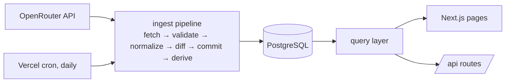

# OneAtlas

OneAtlas is a catalogue of ~470 AI models pulled from OpenRouter's public API. You can search and filter them, compare up to four side by side, see what each provider charges for the same model, and browse rankings, labs and providers. I built it for the Full Stack Engineer internship task.

**Live:** https://oneatlas-tau.vercel.app


[Full demo video (2 min)](docs/media/walkthrough.mp4)

## Features

- **Models** (`/models`): search, and filter by lab, provider, capability, input type, price, context window and open weights. Sort by price, context, release date or score. Filters are kept in the URL.
- **Model page**: specs, pricing, a table of every provider offering the model (price, quantization, uptime), benchmarks, and a breakdown of how its score was calculated.
- **Compare** (`/compare`): up to 4 models. Your selection stays as you browse, and the link can be shared.
- **Rankings** (`/rankings`): leaderboards for intelligence, coding, design, value, context and price. Each one shows where its numbers come from. The overall ranking has sliders to change the weights.
- **Benchmarks** (`/benchmarks`): every benchmark and its source, plus a model × benchmark table.
- **Workload finder** (`/discover`): pick a job (coding, agents, vision, long documents…) and get recommendations with reasons.
- **Labs and providers**: pages for each lab (models, release timeline) and each provider (catalogue, and how its prices compare with others).
- **Engine** (`/engine`): how the data pipeline ran last time, and a log of price, provider and model changes between syncs.
- Global search with <kbd>Ctrl</kbd>+<kbd>K</kbd>, a help panel with <kbd>?</kbd>, light/dark themes, and mobile layouts.

The homepage map plots every model that has both a price and an intelligence score: price left to right, intelligence bottom to top. The contour lines show where models cluster, and the red dashed line marks the models nothing beats on both.

## Stack

Next.js 15 (App Router), React 19, TypeScript, Tailwind CSS 4, Prisma 6, PostgreSQL, Zod, Motion, d3-contour, Vitest and Playwright. Deployed on Vercel with a Neon database.

## How it works



- `scripts/ingest.ts` and `/api/ingest` run the pipeline. It validates every record with zod, keeps model identity separate from provider offerings, compares the new data with the database, and logs what changed (prices, providers, specs).
- The scoring and recommendation code in `src/server/scoring` and `src/server/recommend` doesn't touch the database, which makes it easy to unit test.
- Pages and API routes share the same query functions in `src/server/queries`.

More detail on the schema, data sources, scoring and problems I ran into is in [docs/NOTES.md](docs/NOTES.md).

## API

All responses are `{ data, meta }` or `{ error: { code, message } }`.

| Route | Notes |
|---|---|
| `GET /api/models` | `q`, `lab`, `provider`, `capability`, `modality`, `type`, `maxPrice`, `minContext`, `free`, `openWeights`, `sort`, `page`, `pageSize` |
| `GET /api/models/:slug` | full model record |
| `GET /api/compare?models=a,b` | up to 4 |
| `GET /api/rankings` | `category`, `benchmark`, `capability`, `weights` |
| `GET /api/benchmarks` | list, or a matrix with `benchmarks=a,b` |
| `GET /api/search?q=` | models, labs, providers |
| `GET /api/labs`, `/api/labs/:slug` | |
| `GET /api/providers`, `/api/providers/:slug` | |
| `GET /api/recommend?workload=` | |
| `GET /api/changes`, `/api/engine` | change log, pipeline runs |
| `POST /api/ingest` | needs `Authorization: Bearer $INGEST_SECRET`; `?plan=1` for a dry run |

## Running it locally

You need Node 20+ and Postgres.

```bash
npm install
cp .env.example .env        # set DATABASE_URL, DIRECT_URL, INGEST_SECRET
npx prisma migrate deploy
npm run ingest              # loads real data, about 40 seconds
npm run dev
```

Postgres with Docker:

```bash
docker run -d --name oneatlas-pg -e POSTGRES_USER=atlas -e POSTGRES_PASSWORD=atlas -e POSTGRES_DB=oneatlas -p 5434:5432 postgres:16-alpine
```

Other scripts:

- `npm run ingest -- --plan`: show what would change without writing anything.
- `npm run derive`: recompute scores only.
- `npm run typecheck`
- `npm run lint`

## Tests

```bash
npm test                    # unit + integration (integration needs a loaded database)
npm run build && npm run test:e2e
```

- **Unit:** the pipeline's parsing and price handling, the diff, scoring, recommendations, and query validation.
- **Integration:** calls the API route handlers against a real Postgres. It covers filters, sorting, pagination, errors, rankings, compare and data consistency checks.
- **E2E (Playwright):** the main flows on desktop and a phone-sized screen.

CI runs all three on every push (see `.github/workflows/ci.yml`).

## Known limitations

- Only about 100 models have an Artificial Analysis intelligence score, so most models show a dash instead of an Atlas score.
- Price history starts from the first sync. Nothing older is available.
- The rate limiter is in memory, so each serverless instance has its own count.
- Time-of-day price discounts are ignored; the base price is used.
