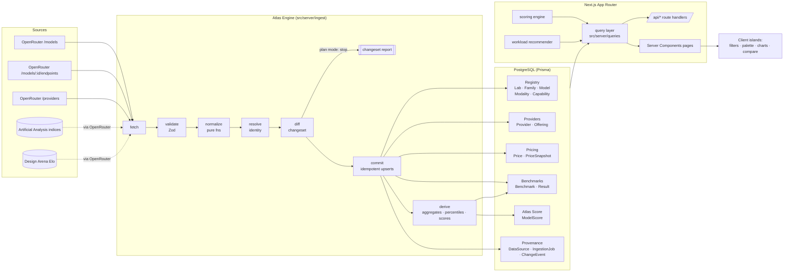

# OneAtlas

**An intelligence layer for the AI model ecosystem.** OneAtlas keeps one normalized registry of ~470 AI models, the 80+ providers that serve them and what each one charges. It scores models with an explainable, versioned method, and it diffs the catalogue on every sync, so you can see the market move.

Built as a full-stack internship assignment with Next.js 15 (App Router), React 19, TypeScript, Tailwind CSS v4, Prisma and PostgreSQL.

> Live: _see deployment section_ · Repo: https://github.com/likhith1253/AI_signal

---

## What makes it different

| | |
|---|---|
| **Atlas Engine (plan / apply / diff)** | Ingestion is a staged pipeline: `fetch → validate → normalize → resolve → diff → commit → derive`. Before writing anything it computes a changeset against the stored catalogue, like `terraform plan` for the model market. `npm run ingest -- --plan` prints it without writing. |
| **Change ledger** | Every observed change (new model, price move, provider added or dropped, spec change, benchmark update) goes to an append-only `ChangeEvent` table. Model "evolution" timelines and price history are built only from these observations and are never back-filled. Within minutes of the first two runs it had recorded real price cuts by an inference provider. |
| **Explainable Atlas Score** | A pure, versioned scoring function (`atlas-v1`) that returns a trace for every dimension: raw input → normalization → weight → contribution. Missing data is excluded rather than zeroed, coverage is published, and no overall score is shown below 60% coverage. |
| **Model ≠ offering** | One identity per model; each provider endpoint is an `Offering` with its own prices, context cap, quantization and uptime. Provider price spreads and "premium vs cheapest alternative" fall out of that schema. |
| **Honest pricing** | Prices are stored as exact decimals in three distinct states: no row (unknown), `0` (free), and `isVariable` (router-priced). Unknown is never sorted, filtered or scored as zero. |
| **Cost-to-capability frontier** | Pareto frontier of intelligence index vs blended price: for any model off the line, something on it is cheaper and at least as capable. |
| **Workload finder** | Deterministic recommendations from declarative workload profiles (hard requirements + weight vector), with a written reason for every pick. No LLM in the loop. |

## Design: a survey atlas

OneAtlas is designed as a cartographic survey of the model market rather than as a SaaS dashboard.

- **The sheet.** Every page is a numbered atlas sheet with a title block, a graticule along the top and legend-box panels with registration ticks. Geometry is square throughout.
- **The terrain map.** The homepage is a topographic map computed from real data. Models are trig-point stations plotted on a fixed datum (AA Intelligence Index × log₁₀ blended price), contours are a kernel-density estimate of where models cluster (`d3-contour`), and the red ridge is the Pareto frontier. The datum is fixed, so each model has a stable **grid reference** (for example `G3·90`), and every model page carries a locator inset.
- **Identity without logos.** Each lab and provider is a geological map unit, with a deterministic hatch pattern, colour and two-letter symbol derived from its slug.
- **Spot heights.** Atlas scores render as surveyed spot heights, with a coverage rule underneath. "uns." (unsurveyed) means there isn't enough data.
- **Typography.** Barlow Condensed for map lettering, Spectral italic for feature names ("Value highlands", "Costly shallows"), Martian Mono for coordinates and figures.
- **Themes.** Day is buff survey paper with iron-gall ink, contour brown, signal red and chart green. Night is a red-lit night chart. The two palettes are tuned separately, not inverted.
- **Motion.** A first-visit triangulation-survey loader (once per session; skipped for reduced motion), contour lines drawing in, a survey-line sweep on route changes, animated re-ranking and counters.

## Architecture



- **Pages are Server Components** that call the query layer directly. Interactive pieces (filters, ⌘K palette, charts, compare tray, weight tuner) are small client islands.
- **API routes** reuse the same query functions and add Zod validation, a consistent `{ data, meta } | { error }` envelope, cache headers and per-IP rate limiting.
- **The scoring engine and recommender are pure TypeScript** with no database access, so they are unit-tested in isolation. Custom weightings are recomputed at request time from the stored per-dimension scores.

See [docs/ARCHITECTURE.md](docs/ARCHITECTURE.md) for design decisions and trade-offs.

## Data

| Entity | Rows (latest local sync) |
|---|---|
| Models | 476 (457 active) |
| Labs | 58 (30 curated profiles) |
| Providers serving models | 83 |
| Offerings (model × provider) | 1,406 |
| Price rows | 5,736 |
| Benchmark results | 3,076 across 40 benchmarks |

All model, provider, pricing and benchmark data is real. It comes from OpenRouter's public API, whose catalogue also carries Artificial Analysis indices and Design Arena Elo ratings. Lab metadata (HQ, founding year, website) is a small curated file. **No synthetic benchmark data is loaded.** The schema supports an `isSynthetic` flag, and the UI labels it if it is ever used. Details: [docs/DATA_SOURCES.md](docs/DATA_SOURCES.md) · Schema: [docs/DATABASE.md](docs/DATABASE.md) · Scoring: [docs/SCORING.md](docs/SCORING.md)

## Features by route

| Route | What it does |
|---|---|
| `/` | Overview: live sync status, change ledger, cost-to-capability frontier, leaders, workloads, value picks, recent releases, ecosystem mix |
| `/models` | Discovery with URL-synced filters (type, capability, modality, price, context, lab, provider, open weights), sorting, pagination, table/grid views |
| `/models/[slug]` | Spec strip, Atlas score wheel + trace, provider price comparison, benchmarks by category (percentile bars), evolution timeline, provenance, family + related |
| `/compare` | Up to 4 models, persisted across pages, shareable URL, best-in-row highlighting, "differences only" |
| `/rankings` | External (AA, Design Arena), specification (context, price) and Atlas-derived leaderboards, each labelled by origin; live weight tuner with animated re-ranking |
| `/benchmarks` | Benchmark registry with sources/coverage and a percentile heat-matrix |
| `/discover` | Workload finder with constraints (price ceiling, min context, open weights) |
| `/labs`, `/labs/[slug]` | Lab directory, release timeline by family, serving providers |
| `/providers`, `/providers/[slug]` | Provider directory; catalogue with price premium vs cheapest alternative |
| `/ecosystem` | Lab × provider distribution matrix, capability coverage by lab |
| `/engine` | Live pipeline diagram with per-stage timings, run history, data freshness, full change ledger |
| `/methodology` | Generated from the scoring code's own constants |

Global: ⌘K / Ctrl+K search (models, labs, providers, pages, recent history), light/dark/system theme without flash, responsive layouts with a mobile drawer and filter bottom sheet, and reduced-motion support.

## API

All endpoints return `{ data, meta? }` or `{ error: { code, message, details? } }`.

| Method | Path | Notes |
|---|---|---|
| GET | `/api/models` | `q, lab, provider, modality, output, capability, type, maxPrice, minContext, free, openWeights, sort, order, page, pageSize` |
| GET | `/api/models/:slug` | full record incl. offerings, prices, history, benchmarks, score trace, ledger |
| GET | `/api/providers`, `/api/providers/:slug` | provider directory / catalogue with price premium |
| GET | `/api/labs`, `/api/labs/:slug` | lab directory / profile |
| GET | `/api/rankings` | `category=overall\|intelligence\|coding\|agentic\|value\|long-context\|cheapest\|design`, `benchmark`, `weights=capability:0.5,value:0.5` |
| GET | `/api/benchmarks` | registry; `benchmarks=a,b` returns a model × benchmark matrix |
| GET | `/api/compare` | `models=a,b,c` (1–4) |
| GET | `/api/search` | grouped instant search |
| GET | `/api/recommend` | `workload, maxPrice, minContext, openWeights` |
| GET | `/api/workloads`, `/api/changes`, `/api/engine` | profiles, ledger, pipeline telemetry |
| POST | `/api/ingest` | **protected**: `Authorization: Bearer $INGEST_SECRET`; `?plan=1` for a dry run |
| GET | `/api/cron/ingest` | **protected**: Vercel Cron with `CRON_SECRET` |

## Getting started

Prerequisites: Node 20+, PostgreSQL 14+ (local Docker is fine).

```bash
git clone https://github.com/likhith1253/AI_signal.git oneatlas && cd oneatlas
npm install
cp .env.example .env            # set DATABASE_URL / DIRECT_URL / INGEST_SECRET
docker run -d --name oneatlas-pg -e POSTGRES_USER=atlas -e POSTGRES_PASSWORD=atlas -e POSTGRES_DB=oneatlas -p 5434:5432 postgres:16-alpine
npx prisma migrate deploy       # create schema
npm run ingest -- --plan        # optional: see what would be written
npm run ingest                  # fetch real data (~40s), commit, derive scores
npm run dev                     # http://localhost:3000
```

### Environment variables

| Variable | Purpose |
|---|---|
| `DATABASE_URL` | Pooled connection string used at runtime (Neon: the `-pooler` host) |
| `DIRECT_URL` | Direct connection used by Prisma migrations |
| `INGEST_SECRET` | Bearer token for `POST /api/ingest` |
| `CRON_SECRET` | Bearer token Vercel Cron sends to `/api/cron/ingest` |
| `NEXT_PUBLIC_SITE_URL` | Optional, absolute URL for metadata |

### Scripts

| Script | |
|---|---|
| `npm run ingest` / `-- --plan` | Run the Atlas Engine (apply / dry run) |
| `npm run derive` | Recompute aggregates, percentiles and scores only |
| `npm run typecheck` · `npm run lint` | TypeScript and ESLint |
| `npm test` | Vitest: unit + integration (integration runs when the DB is seeded) |
| `npm run test:e2e` | Playwright against a production build (`npm run build` first) |

## Testing

- **Unit (53 tests)** cover normalization (slugs, families, prices including tiers, time windows and free vs unknown), the diff engine (idempotency, price/offering/spec/benchmark changes), scoring (percentiles, log-scaled cost, coverage threshold, custom weights), the recommender, the Pareto frontier, validation and query building.
- **Integration (16 tests)** call the real route handlers against PostgreSQL. They cover pagination, AND-semantics filters, sort order with unknowns last, price ceilings excluding unknown prices, 400/404 handling, search ranking, compare alignment, ranking origins and order, recommendation constraints, and auth on ingestion. They also check data integrity: no duplicate offerings, aggregates match offerings, percentile bounds, and no overall score below the coverage threshold.
- **End-to-end (21 Playwright tests, desktop + Pixel 7)** cover navigation, ⌘K search, discovery filters/sort/pagination, model detail, the full compare flow including a shared link in a fresh context, rankings and weight tuning, the workload finder, directories, the engine, theme persistence and system preference, zero console errors, the mobile drawer, the filter sheet, and no horizontal overflow.

## Deployment

Vercel (app) and Neon (PostgreSQL). `vercel.json` runs `prisma migrate deploy` during the build and schedules a daily cron ingest. Steps: [docs/DEPLOYMENT.md](docs/DEPLOYMENT.md).

## Known limitations

- Benchmark coverage is limited to what the upstream catalogue publishes (~100 models have an AA Intelligence Index). Models without benchmarks get dimension scores but no overall Atlas score, by design.
- History starts from the first sync; there is no back-filled price history.
- The rate limiter is per server instance (fine for abuse protection; swap in Redis for strict global limits).
- Time-of-day discount windows that some providers publish are ignored; base prices are used.
- Lab logos are not used. Each lab gets a deterministic geometric mark to avoid trademark and licensing issues.

## Project docs

- [docs/ARCHITECTURE.md](docs/ARCHITECTURE.md): layers, decisions, trade-offs
- [docs/DATABASE.md](docs/DATABASE.md): schema and ER diagram
- [docs/DATA_SOURCES.md](docs/DATA_SOURCES.md): sources, field mapping, provenance
- [docs/SCORING.md](docs/SCORING.md): Atlas score methodology
- [docs/DEPLOYMENT.md](docs/DEPLOYMENT.md): Vercel + Neon
