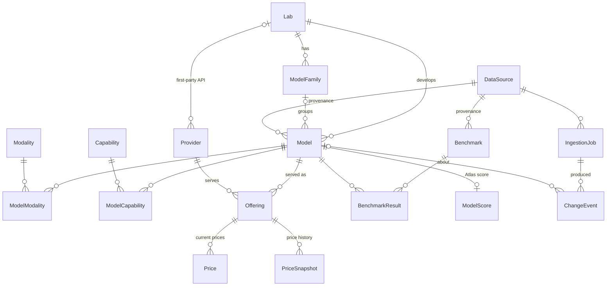

# Database schema

PostgreSQL via Prisma. Source of truth: [`prisma/schema.prisma`](../prisma/schema.prisma). Migrations live in `prisma/migrations`.

## Tables

| Table | Purpose | Keys / constraints | Indexes |
|---|---|---|---|
| `Lab` | Model developer | `slug` unique | |
| `ModelFamily` | e.g. "Claude Sonnet" | `slug` unique, `(labId, name)` unique | |
| `Model` | Registry entry | `slug`, `externalId` unique | lab, family, (type,status), releasedAt, contextLength, blended/min prices, name |
| `Modality`, `ModelModality` | text/image/audio/video/file per direction | PK `(modelId, modalityId, direction)` | (modalityId, direction) |
| `Capability`, `ModelCapability` | tools, reasoning, vision… with evidence | PK `(modelId, capabilityId)` | capabilityId |
| `Provider` | API host | `slug` unique; optional `labId` | |
| `Offering` | model × provider endpoint | `(modelId, tag)` unique | providerId |
| `Price` | current price per component/tier | `(offeringId, component, minPromptTokens)` unique | (component, amountUsd) |
| `PriceSnapshot` | append-only history | | (offeringId, component, capturedAt) |
| `Benchmark` | benchmark definition + scale | `slug` unique | category |
| `BenchmarkResult` | score per model | `(benchmarkId, modelId)` unique | modelId, (benchmarkId, score) |
| `ModelScore` | materialized Atlas dimensions | PK `modelId` | overall, value |
| `DataSource` | provenance | `slug` unique | |
| `IngestionJob` | runs with stage log + errors | | (sourceId, startedAt) |
| `ChangeEvent` | the ledger | | createdAt, (modelId, createdAt), (kind, createdAt) |

## Conventions

- **Money** is `numeric(18,6)` USD (per 1M tokens for token components). Floats are never used for prices.
- **Unknown vs zero:** a missing `Price` row means "not published"; `amountUsd = 0` means free; `isVariable = true` (with null amount) means router-determined.
- **Timestamps:** `createdAt`/`updatedAt` on mutable entities; `observedAt` on benchmark results; `capturedAt` on snapshots; `firstSeenAt`/`lastSyncedAt` on models.
- **Referential integrity:** cascades from model to its children; `SetNull` where history must survive (family, ledger subject).
- **JSON** is used only for genuinely flexible payloads: job stats, stage logs and errors; ledger before/after values; benchmark extras (win rate).

## Why these indexes

Discovery sorts by price, context, release date and score, and filters by lab, type/status, modality and capability. Every one of those paths hits an index or a primary key. Text search uses case-insensitive `contains` over ~470 rows, which is fast without trigram indexes at this size; `pg_trgm` is the next step if the catalogue grows by orders of magnitude.
